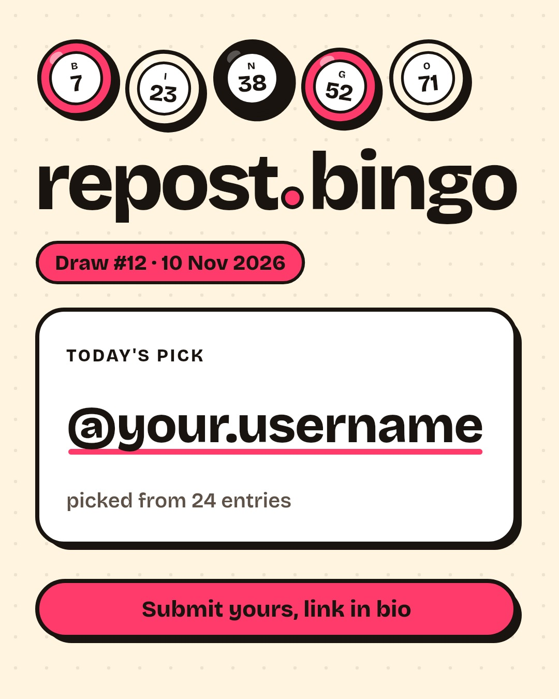
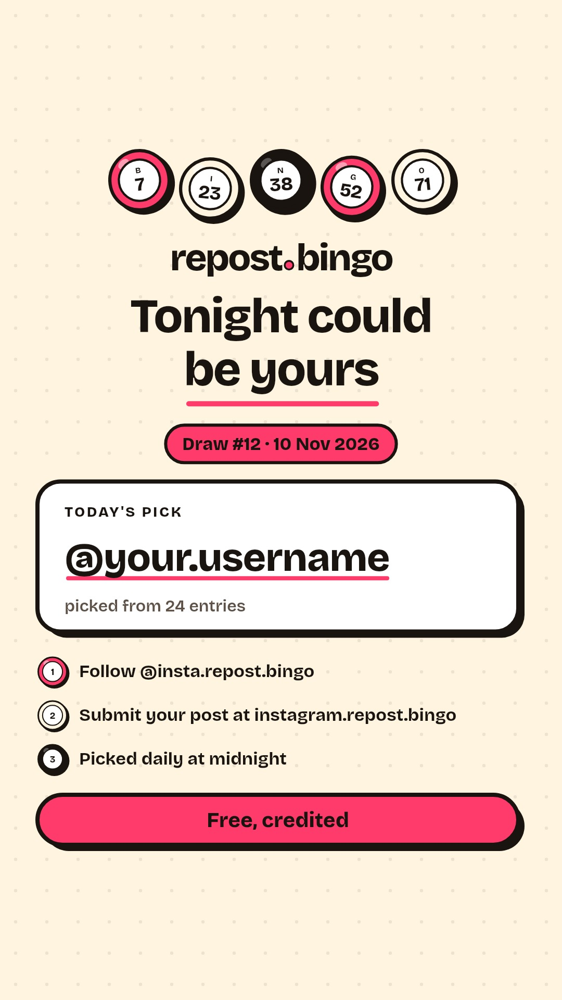

# repost.bingo

The public website for [@insta.repost.bingo](https://www.instagram.com/insta.repost.bingo/): a daily lucky draw for Instagram. People follow the account and submit a link to their own post. Once a day, one entry is picked at random and reposted with credit.

**Domain:** https://repost.bingo (the link in the Instagram bio, so most visitors arrive on a phone)

| Mobile | Desktop |
| --- | --- |
|  |  |

## How it fits together

The system is two repos that share one MongoDB database:

```text
 repost.bingo website (this repo)          draw bot (private repo, repost-bingo-bot)
 - collects entries                        - runs the draw every night at 00:00 London time
 - shows the draw history                  - writes the result to `draws`
 - draws the result card and story on request
            \                                         /
             +------------ MongoDB Atlas ------------+
                 entries: written by the website, picked by the bot
                 draws:   written by the bot, read by the website
```

This repo has no draw, scheduling or Instagram posting logic. It writes new entries, reads results, and draws a result image when asked.

Nothing in this repo posts to Instagram. Whoever runs the account opens the winner's post and taps Repost. The night's story is drawn here, at [`/api/draws/{date}/story.jpg`](#story-image-get-apidrawsdatestoryjpg), for the bot to hand to Instagram. The 4:5 card is still at [`/api/draws/{date}/card.jpg`](#result-card-get-apidrawsdatecardjpg).

## What the site does

It is one public page with no login and no admin:

1. **Intro:** "Follow @insta.repost.bingo. Paste your post link. One random post gets reposted every day, with credit." A Follow button opens the Instagram profile.
2. **Next draw and last night's winner:**
   - A live countdown (hours, minutes, seconds) to the next draw at 00:00 UK time. It is computed in the browser for Europe/London, so it handles GMT and BST.
   - For an hour and a half after midnight the page refreshes its data by itself, so the new result appears soon after the bot writes it.
   - The most recent result is always shown: "Last night's winner", the @username, the date, the entry count and the post links.
3. **Entry form:**
   - One field for the Instagram post link, and a Submit button. There is no username field: the site reads the post's owner from Instagram.
   - The consent line "By entering you confirm it's your own post and allow us to repost it with credit."
   - Success and error messages show inline. The success message names the owner ("You're in, @name!").
4. **Who's in:** everyone in the pool for the next draw, newest first. Each @username links to the entered post.
5. **Draw history:**
   - Results from `draws`, newest first: date, entry count, the winner's @username, a link to the winning post, and a link to the result post if one has been saved in `resultPostUrl`.
   - The first row is always the next draw: "Tonight at 00:00", with the number of entries in the pool.
6. **Footer:**
   - The rules: free, one draw a day, unpicked entries stay in the pool for 7 days, the prize is a repost with credit only, you must follow the account to enter.
   - "Not affiliated with Instagram or Meta."

## Entries: `POST /api/entries`

This is the only write endpoint. It takes JSON `{ url, turnstileToken }` and runs these steps in order:

1. **Basic request checks:** JSON only, body up to 8 KB.
2. **Rate limit per IP:**
   - 10 attempts per 10 minutes, valid or not.
   - The IP comes from Vercel's `x-real-ip` header. `x-forwarded-for` is ignored because clients can set it.
   - Only a keyed hash of the IP is stored, in a `rate_limits` collection that MongoDB clears automatically (TTL index).
3. **Link validation:** `instagram.com` links to `/p/`, `/reel/` or `/tv/` (and `/reels/`), with or without `https://`, `www.` or `m.`. Links that start with `/<username>/` (newer share links) are accepted too.
4. **Normalisation:**
   - Strips the query string (such as `?igsh=...`) and any `#fragment`.
   - Strips the trailing slash.
   - Lowercases the host and always uses `https://www.instagram.com`.
   - Drops a `/<username>/` prefix and spells `/reels/` as `/reel/`.
   - Keeps the post type and the shortcode as they are. Shortcodes are case-sensitive.

   For example, `instagram.com/Some.Creator/reels/C9-kL2mNoPq/?igsh=abc` becomes `https://www.instagram.com/reel/C9-kL2mNoPq`.
5. **Cloudflare Turnstile:**
   - The token is verified server-side with Cloudflare.
   - In production a missing `TURNSTILE_SECRET_KEY` refuses all entries rather than silently switching the check off. Local `bun run dev` skips the check when no key is set.
   - The widget script only loads once someone taps a field. It stays invisible unless Cloudflare needs a click.
6. **Duplicates:**
   - The site checks every post type for the same shortcode. That way a post entered as `/p/...` can't come back as `/reel/...`.
   - A unique index on the normalised `url` also rejects the same link if two people submit it at the same moment.
7. **Owner check with Instagram:** see below. If Instagram can't show the post publicly, the entry is rejected. If Instagram doesn't answer, people are asked to try again in a few minutes. Posts by @insta.repost.bingo itself are rejected.
8. **Insert:** `{ url, username, createdAt, drawDate: null }`, exactly the shared shape. `username` is the owner Instagram reported, in lowercase.

The order matters: bots (Turnstile) and duplicates are stopped before the site asks Instagram anything.

### How the owner check works

- The site loads Instagram's public **embed page** for the post (`https://www.instagram.com/p/<shortcode>/embed/`). This is the page Instagram serves for embedding posts on other websites, and it names the owner.
- Instagram doesn't serve embeds of private posts. So "we can read the owner" also means "the post exists and is public".
- If the embed page is blocked or rate-limited, the site tries the post page and reads the owner from its `og:url`.
- **Caveats:**
  - This isn't an official API. Instagram has none for looking up a post's owner, and its terms don't allow automated collection.
  - It can break if Instagram changes its pages.
  - Instagram rate-limits servers that make many requests. In testing, the post page started returning HTTP 429 after a handful of requests, while the embed page kept working.
  - If Instagram blocks Vercel, entries are refused with "try again in a few minutes". Vercel's logs show `[entries] Instagram didn't answer` when that happens.
- The check proves who owns the post, not that the person submitting is that owner.

### Following is a rule, not a check

- The page tells people they must follow @insta.repost.bingo to enter. It says so in step 1 of the intro, under the link field and in the rules.
- Nothing in this repo checks it, and the page never says it is checked.
- Instagram doesn't show who follows an account without logging in. Its official API only reports a follow for people who have messaged the account, so a real check would need a DM step.
- The bot doesn't check it either. Whoever runs the account can check the winner by hand before reposting.

## Draw history

The history is read-only and comes from `draws`, which the bot writes. It streams in at request time, while the rest of the page is a static shell served from the CDN. "Today" is the calendar date in London, so it handles GMT and BST.

Because the bot owns `draws`, the website checks each document before showing it:

- A document without a valid `YYYY-MM-DD` date is skipped.
- Only real Instagram post links are turned into links.
- Usernames are validated.

The pool size on the next-draw row counts entries with `drawDate: null` from the last 7 days. The bot draws from the same set.

## Result card: `GET /api/draws/{date}/card.jpg`

The winner's card for the draw on that date, drawn on request as a 1080×1350 JPEG, for example `https://repost.bingo/api/draws/2026-11-10/card.jpg`. `{date}` is the draw's `date`: the London day the bot ran, so the draw just after midnight on 10 November is `2026-11-10`.



- **What it shows:** the draw number and date, the winner's @username, the number of entries, and "Submit yours, link in bio", in the page's colours and typeface.
- **For a posting job:** pass the URL as `image_url` when creating the Instagram media container. Instagram downloads the image itself, and its Content Publishing API only accepts JPEG, so no separate image host is needed.
- **Responses:**

| Status | When |
| --- | --- |
| 200 | The JPEG, with `Cache-Control: public, max-age=3600, s-maxage=86400`. |
| 404 | Not a real date, a date after today in London, no draw yet, a night with an empty pool, or a draw document that fails the checks above. Never cached. |
| 429 | More than 30 images drawn for one IP address in 10 minutes. The story counts towards the same limit. |
| 503 | The database is unavailable, or drawing failed. |

- **Cost:** Vercel's CDN keeps each card for a day, so a card is usually drawn once per CDN region. A request with an extra query string skips the cache, which is why drawing is rate-limited (the same keyed IP hash as entries). A card takes about 35 ms to draw, plus about 0.3 s to load Skia when a function starts cold.
- **How:** `lib/result-card.ts` draws it with [`@napi-rs/canvas`](https://github.com/Brooooooklyn/canvas) (Skia) and the variable Bricolage Grotesque in `assets/fonts` (SIL Open Font License). `next.config.ts` keeps the native package out of the bundle (`serverExternalPackages`) and ships the font with the route (`outputFileTracingIncludes`). The Skia binary adds about 37 MB to that one function.
- **Changing the design:** edit `lib/result-card.ts`. Its colours are the tokens in `app/globals.css`, so change them together. A new deploy starts with an empty cache, so cards are drawn again with the new design.

## Story image: `GET /api/draws/{date}/story.jpg`

The same night as a 1080×1920 JPEG for an Instagram story, for example `https://repost.bingo/api/draws/2026-11-10/story.jpg`. `{date}` is the draw's `date`, the same key as the card. The response is a public `image/jpeg` with no redirect, so the bot can pass the URL to Instagram as `image_url`.



It is laid out for a story, not a shrunk card. The winner stays (the @username, the draw number, the date and the entry count). The large line is a pitch, one of four, chosen from the draw number so consecutive nights don't repeat:

- Your post could be next
- Free exposure, every night
- One post. One repost. Every day.
- Tonight could be yours

Under that: follow @insta.repost.bingo, submit a post at instagram.repost.bingo, picked daily at midnight, and "Free, credited". The type and the panels stay inside the story safe zone, about 250px clear at the top and the bottom.

A night with no entries still returns a story, with the line "No entries yet - be the first to get picked", so the bot can post every night. A missing draw, a date after today in London, or a document that fails the usual checks is a 404, same as the card.

It uses the card's cache header (`public, max-age=3600, s-maxage=86400`) and the same per-IP limit (30 images in 10 minutes, one shared bucket).

## Shared data contract

Don't change these shapes without updating the bot.

Both repos must use the same database: the one named in `MONGODB_URI`, or `repost_bingo` if the connection string doesn't name one.

**Draw time and `draws.date`.**
- The bot starts the draw at 00:02 UK time (Europe/London). If a run fails, later runs that night retry by themselves.
- It dates each draw by the London day it ran. The draw just after midnight on 10 November has `date: "2026-11-10"`, so the page shows it as today's result.
- The page doesn't depend on that. The next draw has its own row without a date, and "Last night's winner" is simply the newest result.

| Collection | Shape | Written by | Read by |
| --- | --- | --- | --- |
| `entries` | `{ url (unique), username, createdAt, drawDate \| null }` | website (inserts with `drawDate: null`) | bot |
| `draws` | `{ date "YYYY-MM-DD", drawNumber, entryCount, winnerUrl \| null, winnerUsername \| null, resultPostUrl \| null, createdAt }` | bot | website |

- **`drawNumber`** is 1, 2, 3 and so on, counting nights with an empty pool. Only the result card uses it.
- **`resultPostUrl`** stays `null` until something posts the result and saves the post's link. The draw bot never posts.
- **A night with no entries:** `entryCount: 0` and `null` for the winner. The page shows it as "No winner this day."

Bot-only extras, which the website ignores: `seed` (to check the pick), `status` (`drawn` or `skipped_empty`) and `resultPostId`.

Website-only extras:

- **Unique index on `entries.url`.** The website creates it before its first write, using the default name `url_1`. If the bot creates the same index, nothing happens. If an index or data in the database conflicts with it, the website logs an error and keeps working. It still checks for duplicates before inserting.
- **`rate_limits` collection.** Short-lived per-IP counters with a TTL index. The bot never needs to touch it.

## Tech

- Next.js 16 (App Router, Cache Components) and TypeScript on Vercel.
- MongoDB Atlas through the official `mongodb` driver. One cached client is shared across warm serverless calls, and `attachDatabasePool` from `@vercel/functions` closes idle connections cleanly on Fluid compute.
- Plain CSS with the Bricolage Grotesque font self-hosted by `next/font`. There are no tracking scripts, cookies or images apart from the icon.
- `@napi-rs/canvas` (Skia) draws the result card and the story image in a Node.js function.
- Vitest for tests. The database tests run against a real, throwaway MongoDB (`mongodb-memory-server`).

```text
app/
  page.tsx                 the single page
  layout.tsx, globals.css  font, metadata, styles
  api/entries/route.ts     POST: submit an entry
  api/draws/[date]/card.jpg/route.ts
                           GET: a result card as a JPEG
  api/draws/[date]/story.jpg/route.ts
                           GET: a story image as a JPEG
components/
  EntryForm.tsx            link form, inline messages, Turnstile
  DrawHistory.tsx          history list (read-only, request-time)
lib/
  instagram.ts             link and username validation and normalisation
  instagram-owner.ts       reads a post's owner from Instagram's embed page
  api/create-entry.ts      the entries endpoint logic (tested directly)
  api/draw-card.ts         the card and story endpoint logic (tested directly)
  result-card.ts           draws the result card and the story
  entries.ts, history.ts   MongoDB writes and reads
  collections.ts           shared data contract types and indexes
  rate-limit.ts, turnstile.ts, mongodb.ts
assets/fonts/              Bricolage Grotesque for the card, and its licence
tests/                     unit and integration tests
```

## Local development

You need [Bun](https://bun.sh) (the package manager; `bun.lock` is the lockfile), Node.js 22.12 or newer (24 LTS recommended, Next.js runs on it) and a MongoDB database. Use a separate dev database rather than the bot's production one.

```bash
bun install
```

```bash
cp .env.example .env.local
```

Set `MONGODB_URI` in `.env.local`. Turnstile is optional locally. Leave its keys empty, or use Cloudflare's test keys listed in `.env.example`.

```bash
bun run dev
```

Open http://localhost:3000. To see results in the history, add a document to `draws` in the shape above (the bot normally does this). Its card is at http://localhost:3000/api/draws/YYYY-MM-DD/card.jpg and its story at http://localhost:3000/api/draws/YYYY-MM-DD/story.jpg.

Checks (all pass on `main`):

```bash
bun run test
```

```bash
bun run lint
```

```bash
bun run typecheck
```

```bash
bun run build
```

Use `bun run test`, not `bun test`: the tests use Vitest, and `bun test` would start Bun's own test runner instead. `bun run test` runs:

- Unit tests for link validation and normalisation, usernames, London dates, the midnight countdown (including the nights the clocks change) and formatting.
- Unit tests for the Instagram owner check (embed page, post-page fallback, rate limits and login walls), using a fake `fetch`.
- Integration tests for the entries API: the shared shape, the owner check, duplicates, rate limiting and Turnstile.
- Unit tests for the result card and the story (size, palette, safe zone, hook rotation, long usernames) and integration tests for both image endpoints (dates, empty nights, bad data, the shared rate limit, errors).
- Integration tests for the history, "Who's in" and last night's winner readers, including badly formed documents.

The first run downloads a MongoDB binary (about 120 MB). The build does not need a database.

## Environment variables

| Name | Required | What it is |
| --- | --- | --- |
| `MONGODB_URI` | Yes | Atlas connection string for the cluster the bot uses. The database is the name in the path (`...mongodb.net/<name>?...`). If there's no name, the site uses `repost_bingo` (never the driver's default, `test`) and logs a warning. Either way, the bot must use the same database. |
| `TURNSTILE_SITE_KEY` | Yes (production) | Turnstile site key (public). It is built into the page, so redeploy after changing it. |
| `TURNSTILE_SECRET_KEY` | Yes (production) | Turnstile secret key. It is used to verify tokens, and also as the key for hashing IP addresses in the rate limiter. |

## Deploying to Vercel

1. **MongoDB Atlas**
   - Use the same cluster and database as the bot.
   - Give the website its own database user, limited to reading and writing that database, with a long random password.
   - In **Network Access**, allow `0.0.0.0/0`. Vercel functions don't have fixed IP addresses, so the database is then protected by its credentials and TLS. The alternative is Vercel's paid Static IPs add-on (Pro and Enterprise), which lets you allow-list only those addresses.
   - Put the Vercel function region near the Atlas region (Project Settings > Functions).
2. **Turnstile**
   - In the Cloudflare dashboard, open **Turnstile** and add a widget in "Managed" mode.
   - Add the hostnames `repost.bingo` and `www.repost.bingo`, plus your Vercel preview domain if you want previews to accept entries.
   - Copy the site key and the secret key.
3. **Vercel project**
   - Import the GitHub repo in Vercel. Check that **Framework Preset** is **Next.js** (Settings > Build and Deployment). If the project was created while the repo was still empty, Vercel picks "Other" and the build fails.
   - Leave the install and build commands on their defaults. Vercel sees `bun.lock` and installs with Bun automatically.
   - Add the three environment variables above for Production.
   - Previews also run in production mode, so they need Turnstile keys and their own (non-production) database if you want them to accept entries.
   - Deploy. There are no cron jobs in this repo; the bot runs the draw.

> Vercel's Hobby plan is for non-commercial use only. If repost.bingo is commercial, use a Pro team.

## Point repost.bingo at Vercel (Cloudflare DNS)

The domain stays on Cloudflare DNS. Vercel serves the site and issues the TLS certificate.

1. In Vercel, open **Project > Settings > Domains** and add `repost.bingo`. Also add `www.repost.bingo` when Vercel suggests it.
2. Set `repost.bingo` as the primary domain, and `www.repost.bingo` to redirect to it.
3. Vercel shows the exact records to create: an **A** record for the apex (`repost.bingo`) and a **CNAME** for `www`. Use those values; they can be specific to your project.
4. In Cloudflare, open the zone, then **DNS > Records**:
   - Delete any existing A, AAAA or CNAME records for `@` and `www` that point somewhere else.
   - Add the A record: Name `@`, IPv4 address as shown by Vercel, Proxy status **DNS only** (grey cloud).
   - Add the CNAME record: Name `www`, Target as shown by Vercel, Proxy status **DNS only** (grey cloud).
5. If the zone has **CAA** records, add one that allows `letsencrypt.org` so Vercel can issue the certificate.
6. Wait until Vercel shows both domains as "Valid Configuration". The certificate is issued automatically.

Keep both records grey-clouded. Vercel recommends connecting directly. A second CDN in front of it caches separately, so it can serve stale pages after a deploy. It also adds overhead and hides visitor signals from Vercel's firewall. With the proxy on, the rate limiter would also see Cloudflare's IP addresses instead of visitors'.

## Privacy

- **What we store:**
  - The normalised post link, the username of the account that posted it (read from Instagram) and when the entry was made.
  - Entries are public: the "Who's in" list shows each username and post until it leaves the pool.
  - Winners' usernames and links are public in the history. A result card shows nothing more than the history does.
- **Rate limiting:** a keyed hash of the IP address, kept for about 10 minutes.
- **Third parties:** Cloudflare Turnstile checks that entries come from people. There are no cookies, analytics or other third-party scripts.
- **Removing an entry on request:** delete the document from `entries` in Atlas, looked up by its `url`.

## Licence

MIT. See [LICENSE](LICENSE).
