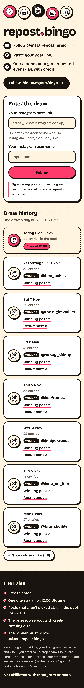
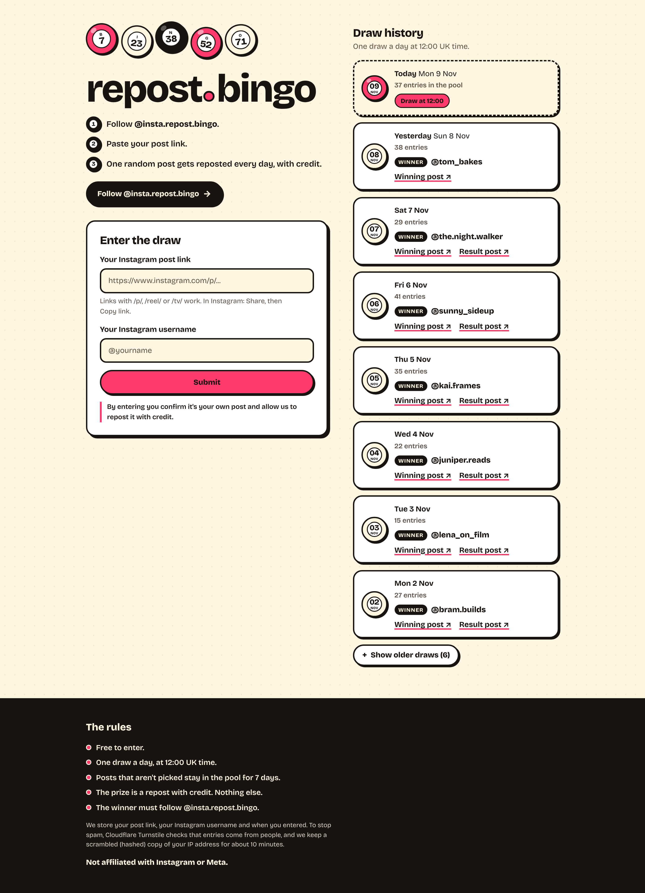

# repost.bingo

The public website for [@insta.repost.bingo](https://www.instagram.com/insta.repost.bingo/): a daily lucky draw for Instagram. People follow the account and submit a link to their own post. Once a day, one entry is picked at random and reposted with credit.

**Domain:** https://repost.bingo (the link in the Instagram bio, so most visitors arrive on a phone)

| Mobile | Desktop |
| --- | --- |
|  |  |

## How it fits together

The system is two repos that share one MongoDB database:

```text
 repost.bingo website (this repo)          repost-bingo-bot (private repo)
 - collects entries                        - runs the daily draw at 12:00 London time
 - shows the draw history                  - writes the result to `draws`
            \                              - posts the result and the repost on Instagram
             \                                        /
              +----------- MongoDB Atlas ------------+
                 entries: written by the website, picked by the bot
                 draws:   written by the bot, read by the website
```

This repo has no draw, scheduling or Instagram posting logic. It only writes new entries and reads results.

## What the site does

It is one public page with no login and no admin:

1. **Intro:** "Follow @insta.repost.bingo. Paste your post link. One random post gets reposted every day, with credit." A Follow button opens the Instagram profile.
2. **Entry form:**
   - An Instagram post link field, a username field and a Submit button.
   - The consent line "By entering you confirm it's your own post and allow us to repost it with credit."
   - Success and error messages show inline.
3. **Draw history:**
   - Results from `draws`, newest first: date, entry count, the winner's @username, a link to the winning post, and a link to the result post once the bot has published it.
   - Today shows "Draw at 12:00", with the number of entries in the pool, until the bot writes today's result.
4. **Footer:**
   - The rules: free, one draw a day, unpicked entries stay in the pool for 7 days, the prize is a repost with credit only, the winner must follow the account.
   - "Not affiliated with Instagram or Meta."

## Entries: `POST /api/entries`

This is the only write endpoint. It takes JSON `{ url, username, turnstileToken }` and runs these steps in order:

1. **Basic request checks:** JSON only, body up to 8 KB.
2. **Rate limit per IP:**
   - 10 attempts per 10 minutes, valid or not.
   - The IP comes from Vercel's `x-real-ip` header. `x-forwarded-for` is ignored because clients can set it.
   - Only a keyed hash of the IP is stored, in a `rate_limits` collection that MongoDB clears automatically (TTL index).
3. **Link validation:** `instagram.com` links to `/p/`, `/reel/` or `/tv/` (and `/reels/`), with or without `https://`, `www.` or `m.`. Links that start with `/<username>/` (newer share links) are accepted too.
4. **Normalisation:**
   - Strips the query string (such as `?igsh=...`) and any `#fragment`.
   - Strips the trailing slash.
   - Lowercases the host and always uses `https://www.instagram.com`.
   - Drops a `/<username>/` prefix and spells `/reels/` as `/reel/`.
   - Keeps the post type and the shortcode as they are. Shortcodes are case-sensitive.

   For example, `instagram.com/Some.Creator/reels/C9-kL2mNoPq/?igsh=abc` becomes `https://www.instagram.com/reel/C9-kL2mNoPq`.
5. **Username validation:**
   - Letters, numbers, full stops and underscores, up to 30 characters.
   - A leading `@` is removed. A pasted profile link works too.
   - Stored in lowercase.
6. **Cloudflare Turnstile:**
   - The token is verified server-side with Cloudflare.
   - In production a missing `TURNSTILE_SECRET_KEY` refuses all entries rather than silently switching the check off. Local `bun run dev` skips the check when no key is set.
   - The widget script only loads once someone taps a field. It stays invisible unless Cloudflare needs a click.
7. **Duplicates:**
   - A unique index on the normalised `url` rejects the same link, even when two people submit it at the same moment.
   - Before inserting, the site also checks the other post types for the same shortcode. That way a post entered as `/p/...` can't come back as `/reel/...`.
8. **Insert:** `{ url, username, createdAt, drawDate: null }`, exactly the shared shape.

## Draw history

The history is read-only and comes from `draws`, which the bot writes. It streams in at request time, while the rest of the page is a static shell served from the CDN. "Today" is the calendar date in London, so it handles GMT and BST.

Because the bot owns `draws`, the website checks each document before showing it:

- A document without a valid `YYYY-MM-DD` date is skipped.
- Only real Instagram post links are turned into links.
- Usernames are validated.

The pool size on today's row counts entries with `drawDate: null` from the last 7 days.

## Shared data contract

Don't change these shapes without updating the bot.

Both repos must use the same database: the one named in `MONGODB_URI`, or `repost_bingo` if the connection string doesn't name one.

| Collection | Shape | Written by | Read by |
| --- | --- | --- | --- |
| `entries` | `{ url (unique), username, createdAt, drawDate \| null }` | website (inserts with `drawDate: null`) | bot |
| `draws` | `{ date "YYYY-MM-DD", entryCount, winnerUrl, winnerUsername, resultPostUrl \| null, createdAt }` | bot | website |

Website-only extras:

- **Unique index on `entries.url`.** The website creates it before its first write, using the default name `url_1`. If the bot creates the same index, nothing happens. If an index or data in the database conflicts with it, the website logs an error and keeps working. It still checks for duplicates before inserting.
- **`rate_limits` collection.** Short-lived per-IP counters with a TTL index. The bot never needs to touch it.

## Tech

- Next.js 16 (App Router, Cache Components) and TypeScript on Vercel.
- MongoDB Atlas through the official `mongodb` driver. One cached client is shared across warm serverless calls, and `attachDatabasePool` from `@vercel/functions` closes idle connections cleanly on Fluid compute.
- Plain CSS with the Bricolage Grotesque font self-hosted by `next/font`. There are no tracking scripts, cookies or images apart from the icon.
- Vitest for tests. The database tests run against a real, throwaway MongoDB (`mongodb-memory-server`).

```text
app/
  page.tsx                 the single page
  layout.tsx, globals.css  font, metadata, styles
  api/entries/route.ts     POST: submit an entry
components/
  EntryForm.tsx            link + username form, inline messages, Turnstile
  DrawHistory.tsx          history list (read-only, request-time)
lib/
  instagram.ts             link and username validation and normalisation
  api/create-entry.ts      the entries endpoint logic (tested directly)
  entries.ts, history.ts   MongoDB writes and reads
  collections.ts           shared data contract types and indexes
  rate-limit.ts, turnstile.ts, mongodb.ts
tests/                     unit and integration tests
```

## Local development

You need [Bun](https://bun.sh) (the package manager; `bun.lock` is the lockfile), Node.js 22.12 or newer (24 LTS recommended, Next.js runs on it) and a MongoDB database. Use a separate dev database rather than the bot's production one.

```bash
bun install
```

```bash
cp .env.example .env.local
```

Set `MONGODB_URI` in `.env.local`. Turnstile is optional locally. Leave its keys empty, or use Cloudflare's test keys listed in `.env.example`.

```bash
bun run dev
```

Open http://localhost:3000. To see results in the history, add a document to `draws` in the shape above (the bot normally does this).

Checks (all pass on `main`):

```bash
bun run test
```

```bash
bun run lint
```

```bash
bun run typecheck
```

```bash
bun run build
```

Use `bun run test`, not `bun test`: the tests use Vitest, and `bun test` would start Bun's own test runner instead. `bun run test` runs:

- Unit tests for link validation and normalisation, usernames, London dates and formatting.
- Integration tests for the entries API: the shared shape, duplicates, rate limiting and Turnstile.
- Integration tests for the history reader, including badly formed draw documents.

The first run downloads a MongoDB binary (about 120 MB). The build does not need a database.

## Environment variables

| Name | Required | What it is |
| --- | --- | --- |
| `MONGODB_URI` | Yes | Atlas connection string for the cluster the bot uses. The database is the name in the path (`...mongodb.net/<name>?...`). If there's no name, the site uses `repost_bingo` (never the driver's default, `test`) and logs a warning. Either way, the bot must use the same database. |
| `TURNSTILE_SITE_KEY` | Yes (production) | Turnstile site key (public). It is built into the page, so redeploy after changing it. |
| `TURNSTILE_SECRET_KEY` | Yes (production) | Turnstile secret key. It is used to verify tokens, and also as the key for hashing IP addresses in the rate limiter. |

## Deploying to Vercel

1. **MongoDB Atlas**
   - Use the same cluster and database as the bot.
   - Give the website its own database user, limited to reading and writing that database, with a long random password.
   - In **Network Access**, allow `0.0.0.0/0`. Vercel functions don't have fixed IP addresses, so the database is then protected by its credentials and TLS. The alternative is Vercel's paid Static IPs add-on (Pro and Enterprise), which lets you allow-list only those addresses.
   - Put the Vercel function region near the Atlas region (Project Settings > Functions).
2. **Turnstile**
   - In the Cloudflare dashboard, open **Turnstile** and add a widget in "Managed" mode.
   - Add the hostnames `repost.bingo` and `www.repost.bingo`, plus your Vercel preview domain if you want previews to accept entries.
   - Copy the site key and the secret key.
3. **Vercel project**
   - Import the GitHub repo in Vercel. Check that **Framework Preset** is **Next.js** (Settings > Build and Deployment). If the project was created while the repo was still empty, Vercel picks "Other" and the build fails.
   - Leave the install and build commands on their defaults. Vercel sees `bun.lock` and installs with Bun automatically.
   - Add the three environment variables above for Production.
   - Previews also run in production mode, so they need Turnstile keys and their own (non-production) database if you want them to accept entries.
   - Deploy. There are no cron jobs in this repo; the bot runs the draw.

> Vercel's Hobby plan is for non-commercial use only. If repost.bingo is commercial, use a Pro team.

## Point repost.bingo at Vercel (Cloudflare DNS)

The domain stays on Cloudflare DNS. Vercel serves the site and issues the TLS certificate.

1. In Vercel, open **Project > Settings > Domains** and add `repost.bingo`. Also add `www.repost.bingo` when Vercel suggests it.
2. Set `repost.bingo` as the primary domain, and `www.repost.bingo` to redirect to it.
3. Vercel shows the exact records to create: an **A** record for the apex (`repost.bingo`) and a **CNAME** for `www`. Use those values; they can be specific to your project.
4. In Cloudflare, open the zone, then **DNS > Records**:
   - Delete any existing A, AAAA or CNAME records for `@` and `www` that point somewhere else.
   - Add the A record: Name `@`, IPv4 address as shown by Vercel, Proxy status **DNS only** (grey cloud).
   - Add the CNAME record: Name `www`, Target as shown by Vercel, Proxy status **DNS only** (grey cloud).
5. If the zone has **CAA** records, add one that allows `letsencrypt.org` so Vercel can issue the certificate.
6. Wait until Vercel shows both domains as "Valid Configuration". The certificate is issued automatically.

Keep both records grey-clouded. Vercel recommends connecting directly. A second CDN in front of it caches separately, so it can serve stale pages after a deploy. It also adds overhead and hides visitor signals from Vercel's firewall. With the proxy on, the rate limiter would also see Cloudflare's IP addresses instead of visitors'.

## Privacy

- **What we store:**
  - The normalised post link, the Instagram username and when the entry was made.
  - Winners' usernames and links are public in the history.
- **Rate limiting:** a keyed hash of the IP address, kept for about 10 minutes.
- **Third parties:** Cloudflare Turnstile checks that entries come from people. There are no cookies, analytics or other third-party scripts.
- **Removing an entry on request:** delete the document from `entries` in Atlas, looked up by its `url`.

## Licence

MIT. See [LICENSE](LICENSE).
